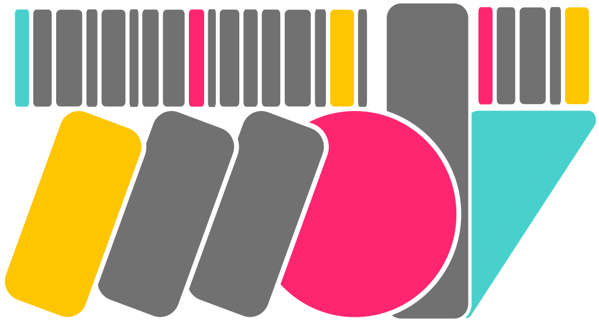

<p align="center">
  
</p>

# Barkod Stüdyo (`barkod_studyo`)

Termal rulo (Argox, Zebra, TSC vb.) ve standart ofis/lazer yazıcılarda **sıfır kayan nokta hatası** ve **sıfır C/C++ çalışma zamanı bağımlılığı** ile çalışan, çoklu sütun destekli yerel masaüstü barkod/etiket basım yazılımı.

## Öne Çıkan Mimari Özellikler

- **%100 Saf Rust & Statik Çalışma Zamanı:**
  - C/SQLite veya harici görüntü işleme kodekleri içermez; Windows'ta `+crt-static` ile **`VCRUNTIME140.dll` gerektirmez** (~3.7 MB tek `.exe`).
- **Sıfır Kayan Nokta Çökmesi (`renderer.rs`):**
  - Barkod (`Code128`, `EAN-13`, `QR Kod`) ve metinler (`+++` manuel + `Genişlik (mm)` otomatik kelime kaydırma + `Sol/Orta/Sağ` hizalama) önce `0°` yatay piksel tamponuna çizilir, ardından tam sayı matris rotasyonu (`0°/90°/180°/270°`) uygulanır.
- **Evrensel Termal Rulo & Ofis Yazıcı Motoru (`printer.rs`):**
  - Çoklu sütunlu rulolarda (`1..=8` sütun) her yatay satır tek sayfa olarak gerçek yazıcı donanım DPI değerinde basılır.
  - Windows'ta sürücü kaynaklı istenmeyen `Landscape (90°)` döndürmelerini iş bazında (`DMORIENT_PORTRAIT`) devre dışı bırakır.
- **Excel / CSV İçe Aktarım & Sıra Aralığı Baskısı:**
  - MS Excel gerektirmeden `.xlsx`, `.xls`, `.ods`, `.csv` okur; istenirse tüm liste, aktif kayıt veya belirli sıra aralığı (ör. `1 - 10`) önizlenip basılabilir.

## Derleme

```bash
cargo test
cargo build --release
```

## macOS & Mac App Store Yol Haritası (Mac Üzerinde Devam Edilecek Adımlar)

1. **`src/main.rs` (Hazır):** `#[cfg(target_os = "macos")]` altında uygulama verileri App Store Sandbox uyumlu `~/Library/Application Support/com.merdura.barkodstudyo/` dizinine yönlendirildi.
2. **`src/printer.rs` (Mac'te eklenecek):** `#[cfg(target_os = "macos")]` bloğuna `objc2-app-kit` üzerinden yerel `NSPrintInfo` / `NSPrintOperation` (`com.apple.security.print` Sandbox uyumlu) yazdırma motoru eklenecek.
3. **`.app` & `.pkg` Paketleme:** `assets/icon_1024.png` hazır kare uygulama ikonundan `sips` + `iconutil` ile `AppIcon.icns` üretilecek; `aarch64-apple-darwin` + `x86_64-apple-darwin` Universal Binary derlemesi, `Info.plist`, `Entitlements.plist` (`app-sandbox`, `print`, `files.user-selected.read-only`) ve `productbuild` imzalama adımları uygulanacak.
